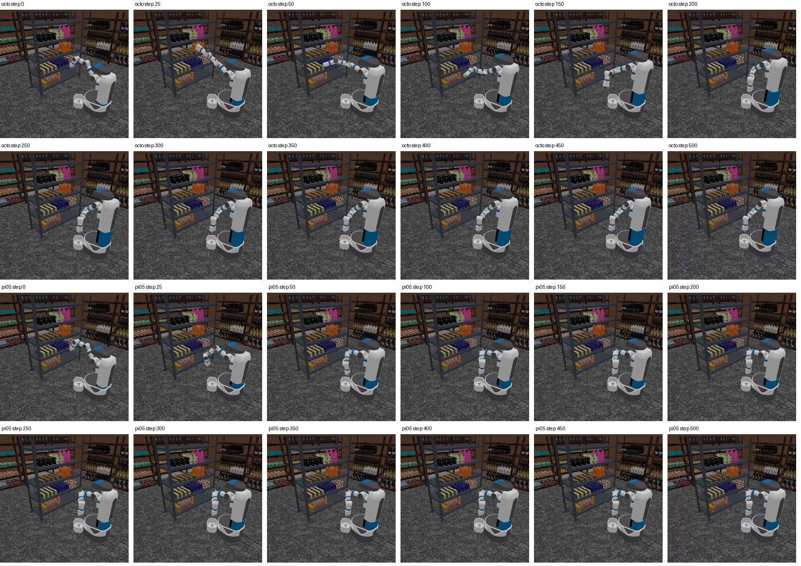

# 零售移动操作 VLA 评测｜RoboBenchMart Evaluation

> **个人项目 · 2026** ｜ 角色：评测工程与算法复现 ｜ 关键词：VLA、具身智能、仿真评测、策略复现



## 一句话

在无人零售的移动操作场景里，把仿真环境、视觉观测和视觉语言动作（VLA）模型接成一条可复现的评测流水线，用统一口径比较两个主流策略，并把“失败”拆成可验证的工程问题。

## 30 秒速览

| 项目 | 内容 |
| --- | --- |
| **我负责** | 仿真与观测接入、动作执行协议、指标落盘、评测口径与离线审计、失败分析 |
| **规模** | 35 组实验 · 135 条轨迹 · 97,300 个仿真步 |
| **主结果** | 评测链路跑通；两个策略在该配置下任务成功 0 次（如实记录，不做美化） |
| **另一条线** | π0-FAST 在 LIBERO 四个标准套件上 2000 次评测，成功 1704 次（85.20%） |
| **交付物** | 评测客户端、模型适配器、配置驱动的审计框架（含 6 项离线测试）、复盘手册 |

## 我做了什么

1. **打通链路**：把 ManiSkill 仿真、三路相机、15 维机器人状态和 OpenPI 模型服务接起来，让一次完整的“观测 → 推理 → 动作 → 记录”跑完并留下轨迹。
2. **统一口径**：把“跑完”“成功”“精度达标”拆成不同指标，避免用漂亮数字掩盖问题。
3. **做对照**：按训练场景 / 随机初始位姿 / 未见场景 / 域外物品四组条件，对比 Octo 与 π0.5 两个策略。
4. **做工具**：写了配置驱动的评测框架（plan / run / audit）和离线审计脚本，换模型不用改统计代码。
5. **做归因**：把 0 成功拆成观测、模型适配、动作、控制器四层可验证假设，而不是一句“模型不行”。

## 关键结果

| 指标 | 结果 | 说明 |
| --- | --- | --- |
| 评测链路 | 跑通 | 35 组 / 135 条 / 97,300 步全部落盘、可审计 |
| 任务成功 | 0 / 135 | 真实记录；失败尚未定位到单一根因，已给出排查路径 |
| 离线测试 | 6 项通过 | 无需 GPU，克隆后一条命令即可复现 |
| LIBERO π0-FAST | 1704 / 2000（85.20%） | 独立实验线，成绩由逐任务截图录入 |

## 技术栈

`Python` `PyTorch` `ManiSkill` `OpenPI` `VLA` `Octo` `π0.5` `π0-FAST` `RLDS / TFDS` `HDF5` `WebSocket` `NumPy` `实验设计与统计分析`

## 适合的岗位方向

- 具身智能 / VLA 算法（评测复现、数据链路）
- 机器人算法工程（仿真、策略接入、实验平台）
- 算法评测 / 机器学习工程（可复现实验、审计工具）

## 项目文档

| 想了解 | 去哪里 |
| --- | --- |
| 评测框架与测试 | [`supplementary/robobenchmart_eval_framework/`](supplementary/robobenchmart_eval_framework/) |
| π0-FAST / LIBERO 结果 | [`libero_pi0_fast/`](libero_pi0_fast/) |
| 证据与来源说明 | [`evidence/`](evidence/)、[`recovery_metadata/`](recovery_metadata/) |

## 说明

这是一个「评测基础设施 + 策略复现」项目，**不包含模型训练或微调**。仓库中的数字都可用两条离线命令复核（见技术部分），上游仿真环境与模型权重由官方项目提供。

---

## 技术细节（给工程师）

以下为仓库的技术说明与证据边界，招聘初筛可以跳过。

## 仓库性质

This repository is a **recovered source snapshot**, NOT a verified full clone of the official RoboBenchMart Git commit. It combines original recovered files and clearly separated later additions.

## What was actually recovered

- `dsynth/`, `scripts/`, `bash/`: Python/shell sources extracted from the 77 MB user backup. Pycache files excluded.
- `openpi_custom/`: recovered OpenPI training configuration and RoboBenchMart input/output adapter. Copy into a **matching** OpenPI checkout only after version comparison.
- `experiments/reports/evaluation_summary.csv`: historical summary (35 experiment directories, 135 recorded trajectories, 0 successes); these are NOT equivalent to the full official benchmark.
- `data/rlds_nivea/`: ~71 MB TFRecord dataset recovered from backup; **dataset creation is not proof of task success**.
- `supplementary/robobenchmart_eval_framework/`: later-developed standalone evaluation auditing/manifest tool with offline tests. It was NOT used to generate historical trajectories.
- `recovery_metadata/`: original git status (historical reference), OpenPI patch; SHA256 manifest.

## Missing — do not present as recovered

- Original `demo_envs` scene generation outputs / evaluations; 18GB original H5/MP4 backup was lost.
- Octo and pi0.5 pretrained checkpoints.
- Some original repo top-level dependencies / setup metadata, plus the former `tests/test_composite_stage_replanning.py` (listed in git status but absent from backup).
- `my_experiments/` and `robobenchmart_extension/` directories (listed as untracked, not present in compact backup).

## Clone this repository

Hosted as a public GitHub repository: <https://github.com/cutelamb2026/RoboBenchMart-VLA-Portfolio>

```bash
gh repo clone cutelamb2026/RoboBenchMart-VLA-Portfolio
# or, with the GitHub credential helper configured:
git clone https://github.com/cutelamb2026/RoboBenchMart-VLA-Portfolio.git
```

GitHub Desktop: **File → Clone repository → GitHub.com → `cutelamb2026/RoboBenchMart-VLA-Portfolio`**. To work from an existing folder instead, use **File → Add local repository**.

The `data/` directory is deliberately gitignored; keep a separate offline copy of the ~70 MB RLDS TFRecord. `git add .` does NOT add weights or large datasets. The small `.zip`/`.mp4` files under `evidence/` are tracked on purpose: `evidence/EVIDENCE_README.md` publishes their SHA-256 digests, so dropping them would leave dangling checksums. The tracked tree is ~28 MB.

## Rebuild execution environment later

1. Obtain a separate checkout of the upstream project: https://github.com/emb-ai/RoboBenchMart.git; record its exact Git commit.
2. Compare `dsynth/`, `scripts/`, and `bash/` in this recovery snapshot against upstream **before copying anything**. Treat this snapshot as the source of personal edits, not a drop-in validated release.
3. Install dependencies following the selected upstream version and compare `requirements/dsynth_requirements.txt` (record of a past environment, not a guaranteed reproducible lockfile).
4. Recreate scenes using official generation scripts; original scene JSONs and evaluation videos were not recovered.
5. Retrieve model weights only when GPU evaluation is needed. Check observation, action mapping and normalization before claiming benchmark parity.

## Offline verification

Three commands, no GPU and no ManiSkill install:

```bash
# 1) evaluation framework: 6 offline tests
cd supplementary/robobenchmart_eval_framework
PYTHONPATH=. python -m unittest discover -s tests -v
PYTHONPATH=. python -m rbm_eval.cli --help

# 2) recompute the LIBERO per-task CSV (expect 1704/2000 = 85.20%)
cd ../..
python3 libero_pi0_fast/analyze_libero.py \
  --input libero_pi0_fast/results.csv --output /tmp/libero_report.json
```

All of them run offline. They validate the tooling and the recorded CSV — not model behaviour on a GPU.

## Historical model evaluation (not newly run)

The uploaded summary contains 35 experiment records and 135 trajectories, with zero recorded successes. Counts may include smoke tests and different conditions, and are not an official reproduced success-rate benchmark.

## Files and provenance

See `recovery_metadata/SHA256SUMS.txt` for file digests, and `recovery_metadata/RECOVERY_REPORT.md` for provenance and caveats.

## New recovered evidence

See `evidence/EVIDENCE_README.md` for OOD logs, 2 MP4 videos, contact sheet, model-method snippets, and their evidence limitations.

## 2026-11-13: official-source bootstrap & separate π0-FAST LIBERO audit

- `bash tools/fetch_official_sources.sh` fetches and pins upstream RoboBenchMart + OpenPI without overwriting recovered code (requires a networked computer).
- `libero_pi0_fast/` contains a **real-results-only** per-task CSV template, validator, success-rate aggregation and tests. Screenshots-derived π0-FAST results are stored in results.csv; no raw rollout logs are claimed.
- `PROJECT_STATUS_2026-11-13.md` explicitly separates historical recovery, live upstream code, and independent LIBERO work.


## 2026-11-13 LIBERO 实际截图结果已补录

`libero_pi0_fast/results.csv` 从用户截图录入：spatial 480/500（96.00%）、object 485/500（97.00%）、goal 438/500（87.60%）、libero_10 301/500（60.20%）；累计 1704/2000（85.20%）。这是根据网页截图反算的成功数，原始逐 episode 日志、checkpoint 和 seed 尚缺；详细见 `libero_pi0_fast/RESULTS_ANALYSIS.md`。之前“尚无成功率”的描述已由此更新。

## 相关项目

- [ReKep Mobile Manipulation](https://github.com/cutelamb2026/rekep-mobile-manipulation) — 基于 ReKep 的工业物流与零售移动操作（另一个独立项目）
